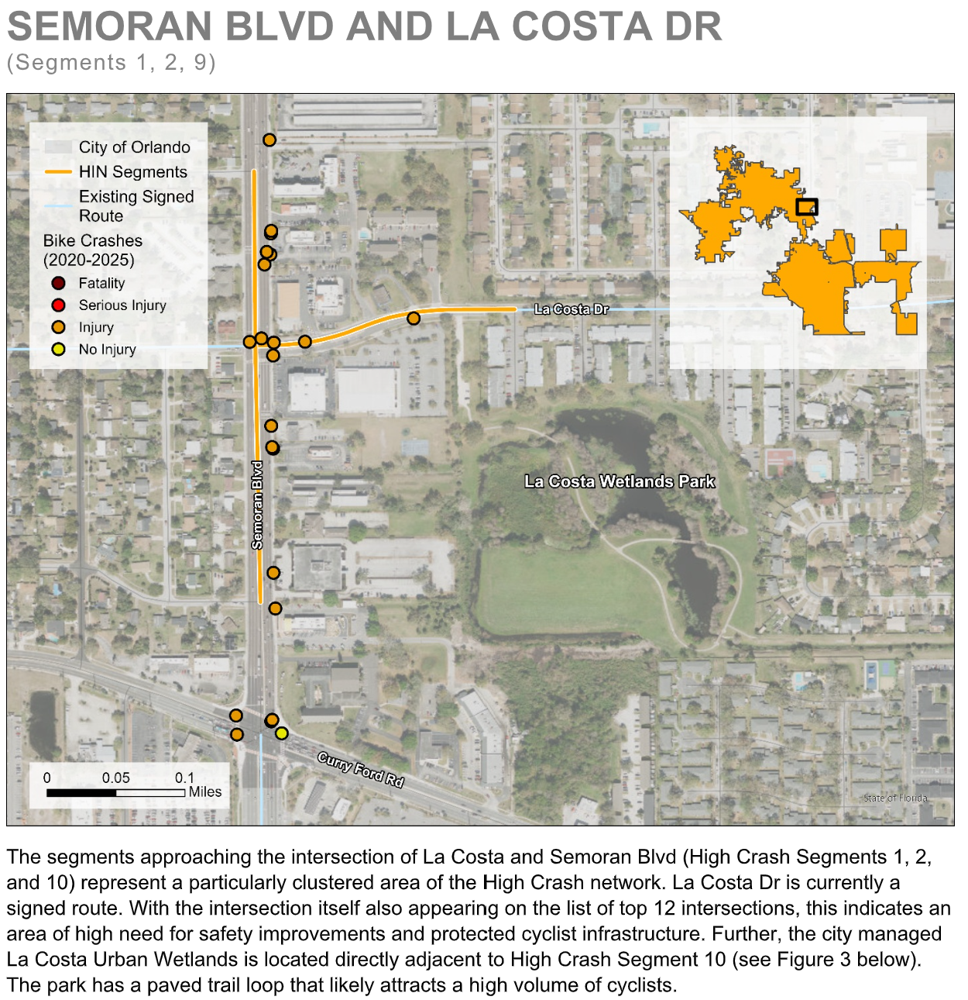

As a part of my summer internship with Kittelson & Associates, I contributed GIS analysis, cartography, and technical writing
to the City of Orlando's 2026 Bike Plan Update. This included analyzing crash data, identifying high-crash corridors, 
and adapting the City's priority network to reflect this bicyclist high injury network. 
I also assisted in the development of a bike latent demand model to identify areas of potential growth 
in cycling infrastructure.

For this project, I also created materials for public engagement, attended an open house, and sythesized public
feedback into actionable changes to the priority network.

Skills: Safety Analysis (Signal 4 Analytics), GIS, Bike Latent Demand Modeling

