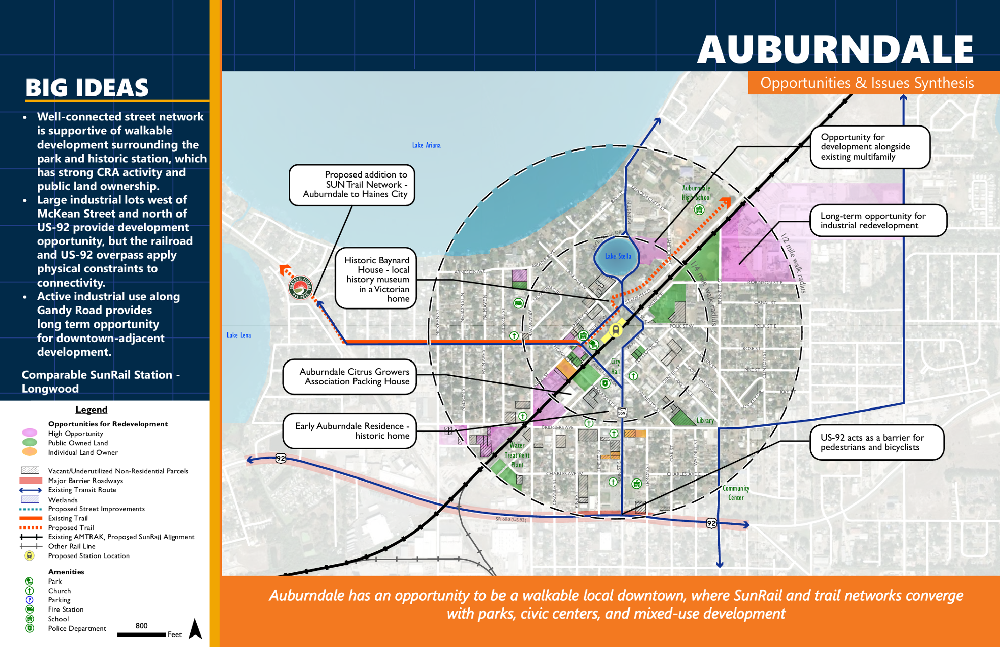

As a part of my summer internship with Kittelson & Associates, I was involved in the beginning stages of a transit-oriented development 
study for a proposed commuter rail expansion in central Florida. My role was conducting a station area synthesis for three 
of seven station areas. This involved parcel-level analysis of land use, zoning, and development potential to identify opportunities 
for densification, existing community assets, and opportunities to strengthen multimodal connections in the station area.

The station areas I worked on ranged from a rural interchange that provides an opportunity for shifting commuters to transit,
to historic downtown cores of several small cities. The diverse contexts and character of each place informed the visions that 
resulted from this synthesis. See below for an example output from such work. 

Skills: parcel analysis, zoning and environmental analysis, InDesign, systems thinking

